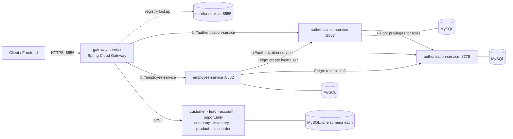
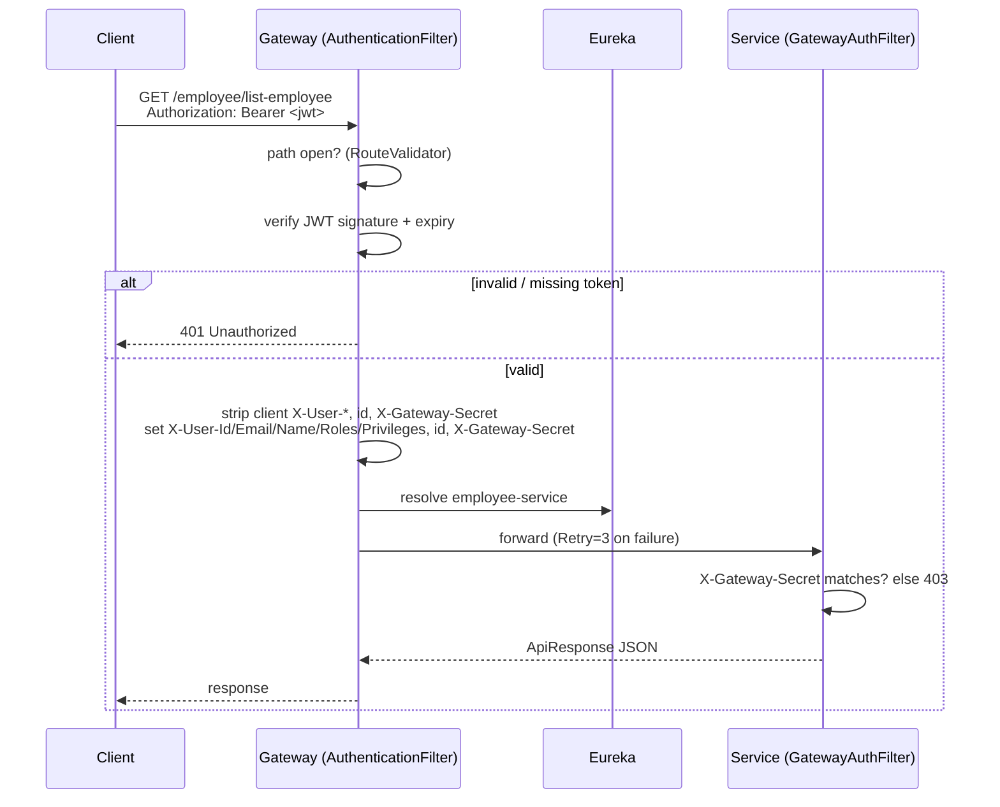
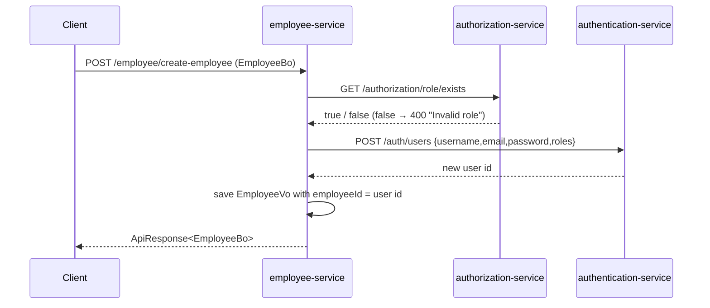

# Architecture

## 1. Big picture



* **One entry point.** Clients only talk to `gateway-service` on port 8556.
* **Service discovery.** Every service registers itself with `eureka-service` under its `spring.application.name`. The gateway and Feign clients resolve `lb://<name>` through Eureka and load-balance with Spring Cloud LoadBalancer.
* **Database per service.** Each business service owns a MySQL schema (`ms_mybiz_<service>`). Nothing reads another service's tables; data from another domain is fetched over HTTP.
* **Synchronous calls only** between the core services (OpenFeign). RabbitMQ appears once — a consumer in `product-service` (see §6).

## 2. Request flow



Details of every step — including which paths are public — are in [SECURITY.md](SECURITY.md).

**Path rule:** the gateway does **not** strip prefixes. A controller must map the full public path itself, e.g. `@RequestMapping("/employee/territory")` is reached at `http://localhost:8556/employee/territory/...`. A controller whose path doesn't start with its service's gateway prefix is unreachable from outside (see `salesorder-service` `/quotes`, `/Invoice` in [KNOWN_ISSUES.md](KNOWN_ISSUES.md)).

## 3. Service map

| Gateway prefix | Route target (`lb://`) | Module actually registered under that name | Notes |
|---|---|---|---|
| `/auth/**` | `authentication-service` | authentication-service | `/auth/signin`, `/auth/signup`, `/auth/signupcheckEmailId/*` are public |
| `/authorization/**` | `authorization-service` | authorization-service | |
| `/employee/**` | `employee-service` | employee-service | |
| `/customer/**` | `customer-service` | customer-service | |
| `/lead/**` | `lead-service` | lead-service | |
| `/account/**` | `account-service` | account-service | |
| `/opportunity/**` | `user-opportunity` | opportunity-service | Eureka name differs from directory name |
| `/company/**` | `company-service` | company-service | |
| `/inventory/**` | `inventory-service` | inventory-service **and** product-service | Both register under the same name → requests are split between two different apps |
| `/salesorder/**` | `salesorder-service` | (none in practice) | salesorder-service doesn't configure the Eureka URL, so it never registers on :8555 |
| `/project/**` | `project-service` | (none) | project-service has no Eureka client |
| `/task/**` | `task-service` | (none) | TaskManagement is named `TaskManagement` and has no Eureka client |
| `/campaign/**` | `campaign-service` | (none) | No module |
| `/contact/**` | `contacts-service` | (none) | No module |

Routes are declared in `gateway-service/src/main/resources/application.properties`. The discovery locator is **off**, so only these explicit routes exist.

## 4. Inter-service calls (OpenFeign)

Feign interfaces live in each caller's `SyncCall` package and address the callee by Eureka name. They mirror the callee's `ApiResponse<T>` envelope (each service has its own copy of that class).

| Caller | Callee | Call | Used for |
|---|---|---|---|
| authentication-service `AuthorizationClient` | authorization-service | `POST /authorization/privilege/privileges` (body: role names) | At sign-in: resolve the user's privileges, which are embedded in the JWT. Sign-in fails if none are returned. |
| employee-service `AuthorizationClient` | authorization-service | `GET /authorization/role/exists?…` | Validate the employee's role before creating anything |
| employee-service `AuthClient` | authentication-service | `POST /auth/users` | Create the login user for a new employee; its id becomes the employee id |

Feign calls go service-to-service via Eureka, **not** through the gateway. Each caller's `GatewaySecretFeignInterceptor` adds `X-Gateway-Secret` so the callee accepts the call. They do **not** forward the end user's identity headers.

### Employee creation (the main cross-service flow)



There is no compensation: if the employee save fails after the login user was created, the user stays behind (see KNOWN_ISSUES).

## 5. Shared response envelope

Newer services (authentication, authorization, employee) return `ResponseEntity<ApiResponse<T>>`:

```json
{
  "success": true,
  "message": "User authenticated successfully",
  "data": { "...": "..." },
  "errors": { "field": "message" },
  "timestamp": "2026-11-16T10:15:30Z"
}
```

`errors` and `data` are omitted when null. Older services (account, lead, customer, inventory, …) return the BO or a plain `ResponseEntity` without the envelope.

## 6. Data stores

| Store | Used by | Notes |
|---|---|---|
| MySQL `localhost:3306` (`root`/`admin`) | authentication, authorization, employee, customer, lead, account, opportunity, company, inventory, salesorder, product (`product_service` schema) | Hibernate `ddl-auto=update` creates/updates **tables**; the **schema must already exist** |
| PostgreSQL `localhost:5432/taskdb` (`postgres`/`admin`) | TaskManagement | |
| RabbitMQ `localhost:5672` (`guest`/`guest`) | product-service | Listens on queue `FinalProductQueue` for `{productId, orderedUnit}` and reduces stock. Nothing in this repo publishes to it, and the declared `productExchange` isn't bound to the queue. |

## 7. Technology versions

| | Version | Where it's set |
|---|---|---|
| Java | 17 (`release=17`) | root `pom.xml` `java.version`, applied by the Spring Boot parent. Modules must not override it. |
| Spring Boot | 2.7.15 | root `pom.xml` parent (`spring-boot-starter-parent`) |
| Spring Cloud | 2021.0.1 / 2021.0.2 / 2021.0.8 (mixed) | each module's `spring-cloud.version` — all accept Boot 2.7, but should be aligned |
| jjwt | 0.11.5 | gateway-service, authentication-service |
| Boot 3.3.0 / 4.0.3 | ai-service / project-service, urlshortner | their own `spring-boot-starter-parent`; use `jakarta.*` instead of `javax.*` |
